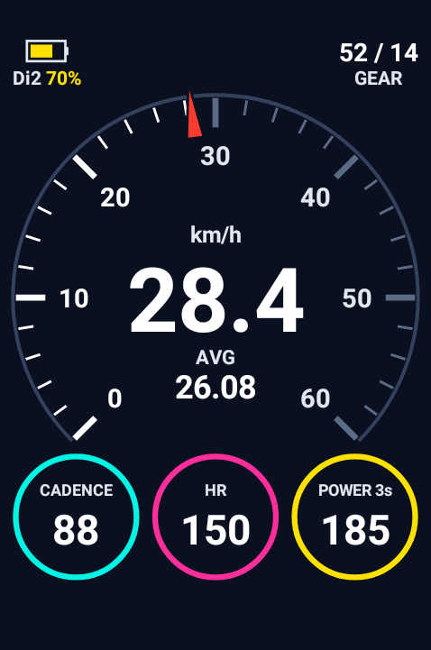

# Karoo Ride Meter

A combined graphical data field for the Hammerhead Karoo 3 (also reported working on the Karoo 2), built on the official
[`io.hammerhead:karoo-ext`](https://github.com/hammerheadnav/karoo-ext) SDK (1.1.9):

- speed on a 270° dial face with numbers and a red pointer,
- a status row on top: shifting battery on the left (SRAM AXS level from the Karoo, or Shimano Di2 % from the
  [Ki2](https://github.com/valterc/ki2) extension) and the gear (front / rear teeth) on the right,
- distance or average speed under the speed (your choice),
- three round fields you choose in "Ride Meter Settings" (slope, cadence, power, HR, …), coloured by your zones.

| Full page | Average speed under the speed | Half page |
|---|---|---|
|  |  |  |

_Rendered by the app's own drawing code (version 1.1.2) with example values._

Split off from Karoo Graphic Meter. Status: see `PROJECT_STATUS.md`. Testers: see `TESTERS.md`.

## Build

Requirements: JDK 17, Android SDK (platform 34), and a GitHub token with `read:packages` in
`~/.gradle/gradle.properties` (`gpr.user`, `gpr.key`).

```bash
JAVA_HOME=/opt/homebrew/opt/openjdk@17/libexec/openjdk.jdk/Contents/Home ./gradlew testDebugUnitTest assembleDebug
```

## Release build (for testers)

Needs `keystore.properties` in the project root (git-ignored) pointing to the release key:

```properties
storeFile=/path/to/karoo-release.jks
storePassword=...
keyAlias=karoo
keyPassword=...
```

```bash
JAVA_HOME=/opt/homebrew/opt/openjdk@17/libexec/openjdk.jdk/Contents/Home ./gradlew assembleRelease
```

APK: `app/build/outputs/apk/release/app-release.apk`. Tester notes: `TESTERS.md`.

## Install on the Karoo

```bash
adb install -r app/build/outputs/apk/debug/app-debug.apk
```

Then add the field from the page editor: **Ride Meter → Ride Meter**. For Shimano Di2 gear data, add the
Di2 in the Karoo as a sensor (Sensors → + → Extensions → Ki2).
